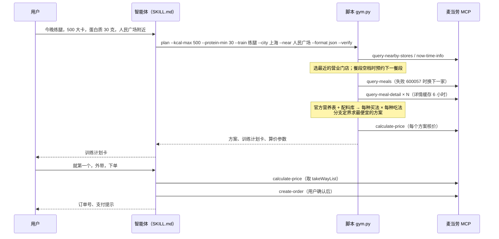

# 麦当劳 MCP 集成说明

## MCP Server

| 项 | 值 |
|---|---|
| 服务 | 麦当劳中国 MCP Server |
| 地址 | `https://mcp.mcd.cn`（Streamable HTTP，JSON-RPC 2.0：`initialize` → `tools/list` → `tools/call`） |
| 鉴权 | 请求头 `Authorization: Bearer <Token>`，Token 只从环境变量 `MCD_MCP_TOKEN` 读取 |
| 客户端 | [`src/mcdstrip/mcp.py`](src/mcdstrip/mcp.py)：读取 `structuredContent`，业务码不是 200 时抛出带业务码的错误；限速与重试 |
| 连接器配置 | [`mcp-config.example.json`](mcp-config.example.json)，给智能体下单用。WorkBuddy 粘贴后把 `${MCD_MCP_TOKEN}` 换成自己的 Token；Claude Code 用 `claude mcp add --transport http ...`，手写 JSON 时 `type` 写 `"http"`。步骤见 [README「连接麦当劳 MCP」](README.md#4-连接麦当劳-mcp) |

## 用到的 Tool

| Tool | 谁调用 | 在流程中的作用 | 关键参数 |
|---|---|---|---|
| `query-nearby-stores` | 脚本 | 按城市和地点关键词找门店，按距离排序；读营业状态和可预约餐段 | `searchType=2`、`city`、`keyword`、`beType=1` |
| `now-time-info` | 脚本 | 取麦当劳服务器时间（北京时间），判断现在是哪个餐段、是否在餐段空档 | 无 |
| `query-meals` | 脚本 | 门店当前（或预约时间）的菜单和价格 | `storeCode`、`orderType=1`、`beType=1`、`reservationDate` |
| `query-meal-detail` | 脚本 | 每个餐品可去的配料（`modification`）、套餐每组的可选项、份数和差价 | 同上加 `code` |
| `list-nutrition-foods` | 脚本（采集快照） | 官方营养表：配料库求解的观测值，整份营养的锚点 | 无 |
| `calculate-price` | 脚本（`--verify`）和智能体 | 核对每个方案的价格；返回堂食、外带等取餐方式 | `items`（套餐带 `roundList`，去配料带 `modification`） |
| `create-order` | 智能体，**仅在用户明确确认后** | 下单 | 门店参数 + `items` + `takeWayCode` |
| `query-order` | 智能体 | 查询订单状态 | `orderId` |

## 调用流程

## 每个 Tool 带来的业务价值

- **`list-nutrition-foods` + `query-meal-detail`**：前者给出约 160 款餐品的整份营养，后者给出每款能去掉哪些配料。两者结合，我们反推出每种配料的营养（[配料库](skill/maimen-gym/references/nutrition-method.md)），于是能回答官方数据回答不了的问题：「双层吉士汉堡去吉士、只吃馅，吃进去多少？」答案是约 182 大卡、16 克蛋白、2 克碳水，面包（约 157 大卡）留作明天的早餐。
- **`query-meals` + `query-meal-detail`**：套餐每组的可选项、份数和差价，决定了「同样的东西怎么买最便宜」。一家店展开后有上千种买法和吃法，交给求解器挑。
- **`query-nearby-stores` + `now-time-info`**：用户只说地点，不用记门店编码；早餐和午餐之间的空档会自动预约下一餐段，不会给出买不到的东西。
- **`calculate-price`**：每个方案都用官方算价核对，展示给用户的价格就是下单价。
- **`create-order` + `query-order`**：从「算出来」到「吃到嘴里」一步完成，但下单永远等用户确认。

## 实测得到的接口事实

开发中用真实 Token 调用验证过，写进了代码和测试：

1. **去配料要整组传。** 保留的传 `selectedKey`、数量 1，去掉的传 `unselectedKey`、数量 0；漏传的配料会被静默恢复成默认。去配料不改价。
2. **面包不在任何可去配料里**，所以「只吃馅」只能到手自拆，脚本把它作为吃法而不是下单参数。
3. **套餐组有份数。** `round.quantity` 可能是 2 或 3（如「堡堡随心拼」主食 2、小食 3、饮料 2），`choice.maxQuantity` 限制单项份数；`comboItemList` 里同一配置合并并带数量。
4. **随单购价格。** 标着「随单购麦金卡优惠」「随单购早餐卡优惠」的商品，不带 `withOrder` 算价按 `originalPrice` 收（人气超值四件套 ¥57，而不是标价 ¥28）；带上会多一张卡（麦金卡体验卡 ¥9.9、6 折满分早餐卡 ¥11.9）。脚本默认按原价，不替用户买卡。
5. **600057**：门店临时停业或餐段切换空档，`query-meals` 和预约时间都会返回；**600014**：地点搜不到。
6. 2026-10-15 晚在人民广场附近的门店，三组不同约束下共 9 个推荐方案（含套餐去配料、多份），脚本预测价与 `calculate-price` 返回价 9/9 一致。那次没有保存原始记录；用 `python3 scripts/price_check_record.py` 可以重跑三组约束并生成不含 Token 的核价记录（存到 `docs/research/price_check_<日期>.json`）。

## 安全

- Token 只从环境变量读取，不写入文件、不进日志、不进仓库。
- 脚本只调用只读工具和 `calculate-price`。`create-order` 只能由智能体在用户明确确认后调用；不领券、不抽奖、不买会员卡。
- 错误给用户只显示友好的描述；加 `-v` 运行时，详细日志输出到终端（stderr），不写文件，日志里没有 Token。
